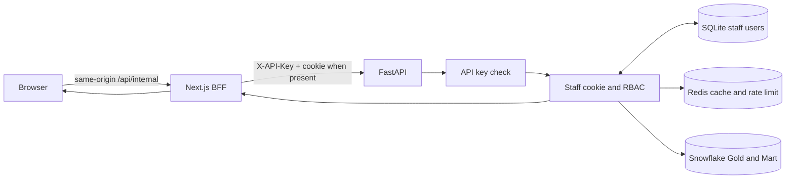

# API — Architecture & Request Lineage

FastAPI là lớp server-side analytics API. Next.js là client nội bộ được phép gọi API;
browser không giữ `API_KEY`. Dữ liệu dashboard chỉ được đọc từ Snowflake.

## 1. Request flow



## 2. Endpoint sequence

| Client path | FastAPI path | Result |
|---|---|---|
| `POST /api/internal/staff/login` | `POST /api/staff/login` | Xác thực account; Next chuyển `Set-Cookie` về browser |
| `GET /api/internal/staff/me` | `GET /api/staff/me` | Trả staff profile và danh sách metric theo role |
| `POST /api/internal/staff/logout` | `POST /api/staff/logout` | Xóa session cookie |
| `GET /api/internal/dashboard/{metric}` | `GET /api/dashboard/{metric}` | Kiểm tra key, session, role, input; cache hoặc query Snowflake |
| `GET /api/health` trên Next | `GET /api/health/live` | Probe API server-side; trả `api=up/down` |

Direct FastAPI dashboard/staff routes vẫn yêu cầu `X-API-Key`; dashboard còn yêu cầu
cookie staff. `/api/dashboard` trả metric/contract staff được xem, còn metric cụ thể
được validate theo `METRIC_CONTRACTS`.

## 3. Metric và nguồn

| Metric | Snowflake source |
|---|---|
| `kpi` | Gold `fact_sales` |
| `revenue-trend` | Mart `mart_revenue_monthly` |
| `by-category` | Mart `mart_revenue_monthly` |
| `by-region` | Mart `mart_revenue_monthly` |
| `top-products` | Gold `fact_sales` + `dim_product` |

Luồng query: validate tháng/limit → tạo cache key → đọc Redis → nếu cache miss hoặc
Redis lỗi thì query parameterized Snowflake → validate contract → cache kết quả.
Query/contract lỗi trả `502`; Redis lỗi không chặn query.

## 4. Module map

```text
api/app.py                    Tạo FastAPI app, lifespan Redis, middleware/router
api/routers/dashboard.py      API key, staff session/RBAC, metric endpoints
api/routers/staff.py          Login, logout, current staff
api/routers/health.py         Liveness/readiness; readiness thường kiểm tra Snowflake
api/routers/operations.py     Probe nhẹ, staff-store/Redis readiness, Prometheus /metrics
api/services/dashboard.py    Kiểm tra month key
api/schemas/                  Request/response models
analytics/                    Snowflake connection, SQL, relation allowlist, contracts
core/                         Config, auth, staff, cache, rate limit, IP, logs
scripts/manage_staff.py       CLI account management
```

## 5. Security and operational boundaries

- `API_KEY`: shared secret giữa Next server và FastAPI; không phải staff login.
- `STAFF_JWT_SECRET`: ký session token; cookie `superstore_staff` là `HttpOnly`,
  `SameSite=Lax`, có TTL và `Secure` theo config.
- FastAPI route `/api/staff/*` và `/api/dashboard*` yêu cầu key. Login không bỏ qua key.
- Role kiểm tra lại ở backend cho từng metric; ẩn metric trên UI không thay thế RBAC.
- `GET /api/health/live` phục vụ probe nhanh và trả release SHA; `/api/health/ready`
  kiểm tra SQLite/Redis, còn `/health/ready` kiểm tra Snowflake/Redis.
- Production Nginx chỉ proxy `/api/`; readiness nội bộ, `/docs`, `/openapi.json` và
  `/metrics` không được public.

Cài đặt và vận hành: [operation.md](operation.md). Frontend BFF:
[Frontend Architecture](../frontend/system_architecture_lineage.md).
