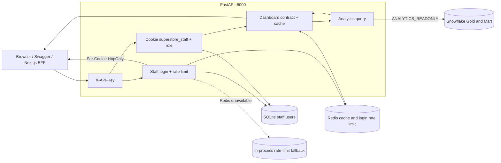
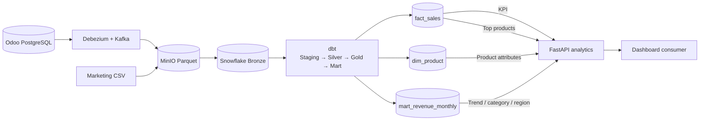
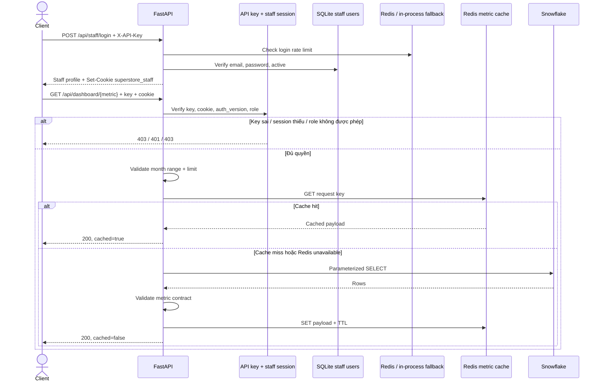
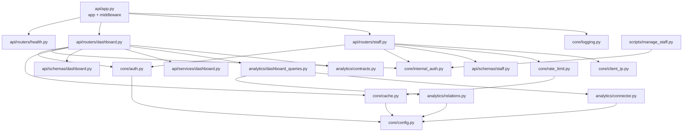
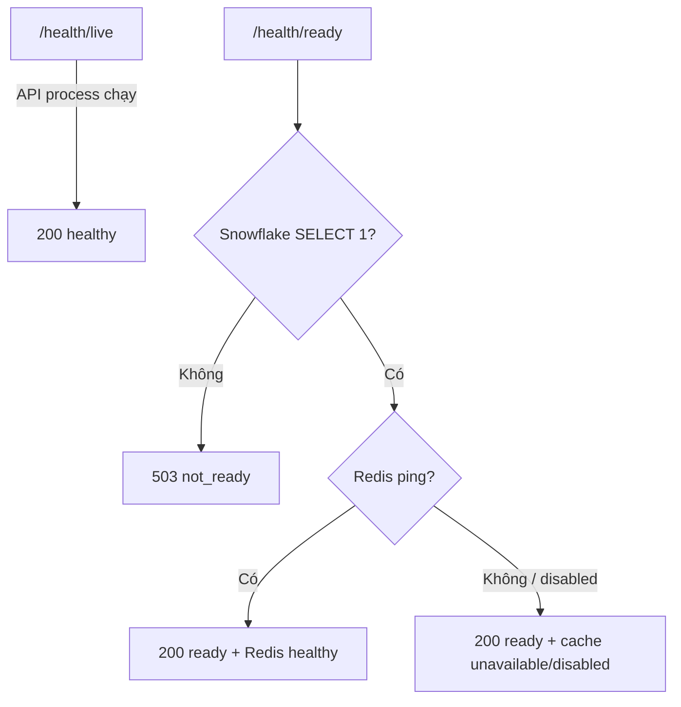

# API System Architecture & Lineage

API cung cấp dữ liệu phân tích chỉ đọc từ Snowflake. Các route `/api/staff/*` và
`/api/dashboard*` đều yêu cầu `X-API-Key`; dashboard còn yêu cầu cookie đăng nhập
staff và kiểm tra role. Redis phục vụ cache metric và rate limit login;
khi Redis lỗi, rate limit dùng bộ đếm trong tiến trình.

## 1. Kiến trúc tổng thể

`API_KEY` xác thực client nội bộ; `STAFF_JWT_SECRET` ký session staff. Tài khoản
staff được lưu ở `RAG_CHATBOT/data/internal_users.db` (Docker mount vào `/app/data`).

## 2. Data lineage

| API metric | Snowflake source |
|---|---|
| `kpi` | `ANALYTIC_LAYER_GOLD_LAYER.fact_sales` |
| `revenue-trend` | `ANALYTIC_LAYER_MART_LAYER.mart_revenue_monthly` |
| `by-category` | `ANALYTIC_LAYER_MART_LAYER.mart_revenue_monthly` |
| `by-region` | `ANALYTIC_LAYER_MART_LAYER.mart_revenue_monthly` |
| `top-products` | `ANALYTIC_LAYER_GOLD_LAYER.fact_sales` + `dim_product` |

## 3. Luồng xử lý một request

Login có giới hạn mặc định 10 lần/phút theo IP mà API nhìn thấy. Redis là
bộ đếm chính; Redis lỗi thì dùng fallback trong tiến trình. Sau BFF Docker,
nhiều người có thể dùng chung IP container nếu `TRUST_PROXY_HEADERS=false`. Dashboard
`/api/dashboard` chỉ trả metric được role phép xem; metric
không được phép trả `403`. Redis cache lỗi thì API vẫn truy vấn Snowflake. Snowflake
lỗi hoặc metric sai contract trả `502`.

## 4. Cấu trúc module

## 5. Health và quyền truy cập

- Snowflake user: `SUPERSTORE_API_USER`.
- Snowflake role: `ANALYTICS_READONLY`.
- Role chỉ có `USAGE` và `SELECT` trên Gold/Mart; không có quyền ghi.
- API key được so sánh an toàn và không truyền qua query string.
- Staff password được hash bằng scrypt; JWT `HttpOnly` có hạn dùng (mặc định 8 giờ).
- Thay role, password hoặc disable user làm session cũ mất hiệu lực qua `auth_version`.
- `admin`/`analyst` thấy mọi metric; `ceo`, `cfo`, `sales` thấy các nhóm được khai báo
  trong `METRIC_CONTRACTS`. Các role khác hiện chưa có dashboard metric.
- `POST /api/staff/logout` xóa cookie; `/api/staff/me` cho biết role và metric được phép.
- SQL sử dụng parameter binding; tên database/schema/table được kiểm tra trước khi ghép.
- Kết quả bị giới hạn bởi `SNOWFLAKE_MAX_ROWS` và query timeout.

Hướng dẫn cài đặt, smoke test và quality gate: [operation.md](operation.md).
