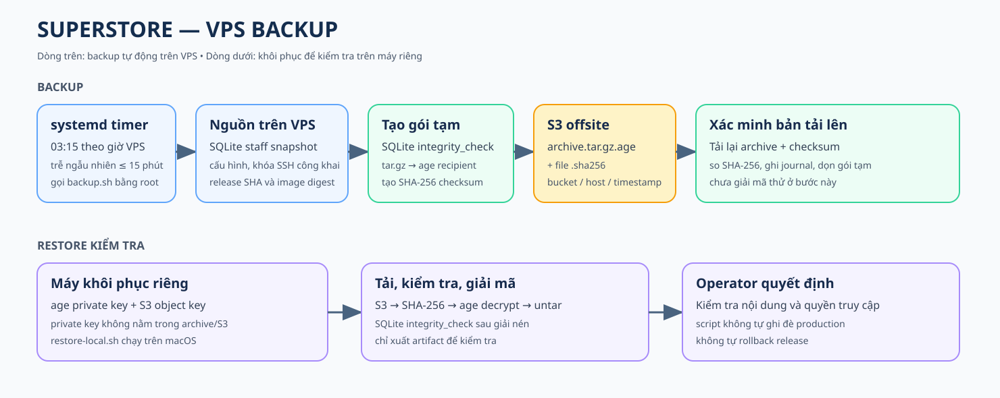

# Backup — System Architecture & Lineage



## 1. Luồng backup

```text
systemd timer (03:15 giờ VPS, trễ tối đa 15 phút)
  → backup.service → backup.sh (root)
  → xác minh AWS identity + flock chống chạy trùng
  → snapshot SQLite staff trong API container → integrity_check
  → gom cấu hình VPS + release metadata vào work.*
  → tar.gz → mã hóa age → tạo SHA-256
  → S3: .tar.gz.age + .sha256
  → tải lại hai file → kiểm tra SHA-256 → dọn file tạm
```

Nguồn được gom: staff DB; `app.env`, `stack.env`, `grafana.env`, image env,
Snowflake secret nếu có; cấu hình Nginx, sudo, SSH public keys; release SHA,
API image digest và danh sách apt package. `/etc/superstore/backup.env` chứa
AWS credential và age public recipient, **không nằm trong archive**. Age private
key chỉ nằm trên máy khôi phục.

## 2. Giữ hay xóa sau mỗi lượt

```text
VPS
├── /opt/superstore/current/deploy/production/backup/  GIỮ; source install.sh đọc
├── /usr/local/lib/superstore-backup/                 TẠO khi cài; GIỮ
│   └── backup.sh                                     Bản copy chạy hằng ngày; GIỮ
├── /etc/systemd/system/                              TẠO/CẬP NHẬT khi cài
│   ├── superstore-backup.service                     GIỮ; gọi backup.sh
│   └── superstore-backup.timer                       GIỮ; đặt lịch và được bật
├── staff DB và cấu hình gốc                          GIỮ, không chỉnh sửa
├── /etc/superstore/backup.env                       GIỮ, root quản lý
├── /var/lib/superstore-backup/                       GIỮ thư mục cha
│   └── work.XXXXXX/                                 XÓA khi script kết thúc
│       ├── SQLite snapshot, cấu hình                TẠM, có dữ liệu chưa mã hóa
│       ├── .tar.gz và .tar.gz.age                   TẠM
│       └── bản tải từ S3 + .sha256                  TẠM để xác minh
├── API container /tmp/superstore-staff-backup.db    XÓA
└── /var/lock/superstore-backup.lock                 GIỮ file; nhả flock khi process thoát

S3
└── <bucket>/<prefix>/<host>/<UTC timestamp>/
    ├── superstore-<id>.tar.gz.age          GIỮ, archive đã mã hóa
    └── superstore-<id>.tar.gz.age.sha256   GIỮ, checksum
```

`work.*` được bảo vệ bằng quyền root và dọn qua `trap EXIT`. Nếu VPS tắt đột
ngột hoặc process bị `SIGKILL`, cần kiểm tra thư mục tạm còn sót. Script không
tự xóa backup cũ trên S3.

`install.sh` chỉ cài `backup.sh` và hai systemd unit ở trên, kiểm tra cú pháp,
reload systemd rồi bật timer. Nó không tạo `backup.env`; operator cấu hình file
này riêng. Các file đã cài được giữ qua các lượt backup và không tự cập nhật
khi source trong release thay đổi.

## 3. Restore kiểm tra

```text
Máy khôi phục riêng
S3 object + .sha256 → so checksum → age private key giải mã
  → giải nén vào thư mục restore mới → SQLite integrity_check
  → operator kiểm tra artifact; không tự ghi đè production
```

`restore-local.sh` tạo thư mục tải tạm rồi dọn khi kết thúc; lệnh giải nén và
kiểm tra SQLite dùng được trên macOS. Kiểm tra SHA-256 sau upload chỉ xác nhận
byte tải về; cần chạy restore drill định kỳ để chứng minh khả năng giải mã.
Trên máy khôi phục, `download-*` bị xóa khi kết thúc, còn `restore-*` được giữ
để operator kiểm tra và phải xóa an toàn sau khi dùng vì chứa secret đã giải mã.

Backup này không chứa Snowflake, dữ liệu MinIO/Redis, logs, certificate, toàn bộ release
source hoặc Docker image. Xem [kiến trúc deploy](../system_architecture_lineage.md)
để thấy vị trí backup trong production.
