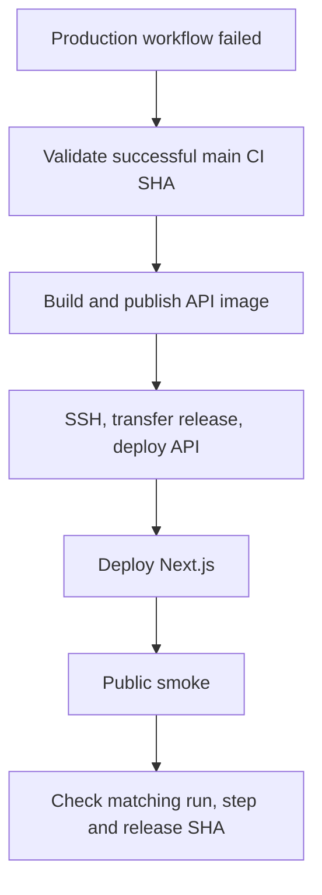

# Deploy — Truy vết lỗi CI/CD và production

## 1. Xác định stage bị lỗi



Mở GitHub Actions → `Superstore Production` → job `Deploy API and frontend, then smoke test`;
đọc step fail đầu tiên. Không dán secrets hoặc toàn bộ environment vào issue.

## 2. Lỗi theo giai đoạn

| Giai đoạn/step | Dấu hiệu | Kiểm tra |
|---|---|---|
| Workflow không bắt đầu | Quality Gate fail, PR run hoặc branch không phải `main` | Quality Gate run; CD chỉ nhận successful push trên `main` của repo hiện tại |
| `Validate successful main CI commit` | stale SHA / checkout mismatch | `main` đã tiến trước khi deploy; push lại code cần deploy để Quality Gate chạy commit mới |
| `Build and push API image by commit SHA` | GHCR login/push/build fail | `packages: write`, Docker build context `RAG_CHATBOT`, GitHub package permissions |
| `Prepare and validate SSH credentials` | thiếu/format sai variable hoặc secret | GitHub Environment `production`: VPS host/port/user, private key, known_hosts |
| `Transfer release files and deploy API` | SSH/SCP/sudo lỗi | VPS DNS/port/firewall, deploy authorized key, host key, `sudo -n`, disk, release directory |
| Remote `deploy.sh` | `compose.yml`, lockfile, config hoặc health lỗi | `/etc/superstore/{app.env,stack.env,images.lock.env}`, Nginx `nginx -t`, Docker pull/compose logs |
| `Deploy Next.js to Vercel` | `vercel pull/build/deploy` lỗi | Vercel token, org/project IDs, production env, `npm ci`, Vercel project/repository binding |
| `Smoke test production website and CFO access` | case `DEPLOY-01`…`DEPLOY-06` fail | `FRONTEND_ORIGIN`, monitor CFO account, website/API routing, cookie, role, KPI contract |

## 3. Chẩn đoán trên VPS

```bash
sudo systemctl status nginx --no-pager
sudo nginx -t
sudo docker ps -a
sudo docker compose -p superstore \
  --env-file /etc/superstore/stack.env \
  --env-file /opt/superstore/current/images.lock.env \
  --env-file /opt/superstore/current/release.env \
  -f /opt/superstore/current/deploy/production/compose.yml ps
```

Log API/Nginx và lệnh kiểm tra endpoint nằm trong
[Deploy Operations](operation.md#8-kiem-tra-logs-va-khoi-phuc).
API compose log có thể xem bằng:

```bash
sudo bash /opt/superstore/current/deploy/production/bin/compose.sh logs --tail=100 api redis
```

## 4. Khôi phục và giới hạn rollback

- Nếu `deploy.sh` lỗi giữa lúc deploy, script tự thử chạy container của release trước.
  Xác minh public liveness và internal readiness sau đó.
- Nếu deploy script đã hoàn tất nhưng Vercel hoặc production smoke lỗi, workflow **không**
  tự rollback cả API và frontend. Dừng deploy tiếp, xác định tầng lỗi và dùng release/Vercel
  deployment trước theo quy trình được duyệt.
- Smoke test dùng account CFO production và có thể ghi rate-limit/cache/logs. Không chạy lại
  script local bằng credential production ngoài workflow được phép.

Kiến trúc và danh sách file: [system_architecture_lineage.md](system_architecture_lineage.md).
Thiết lập và vận hành: [operation.md](operation.md).
