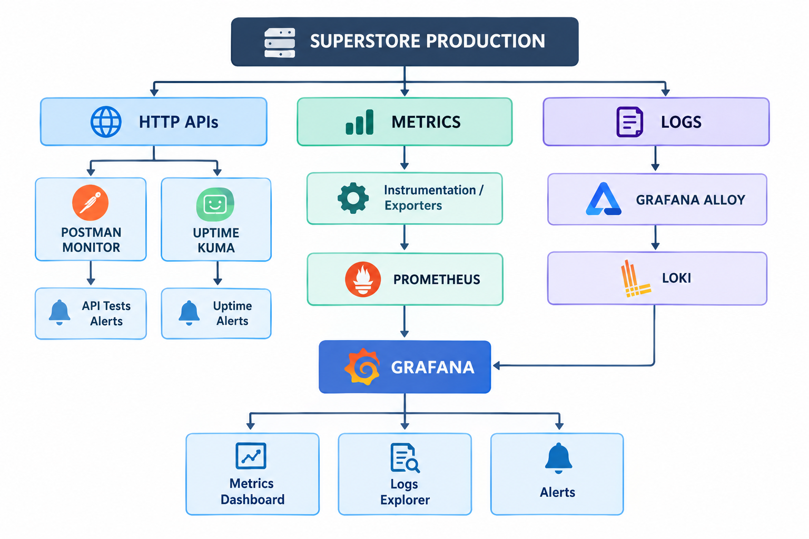
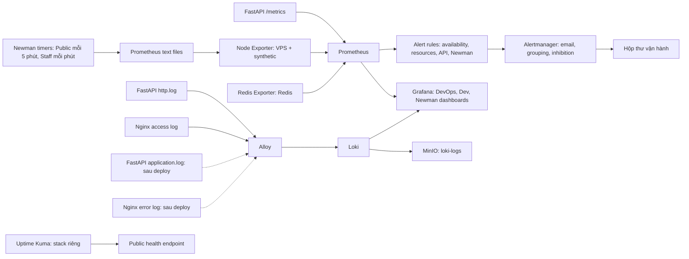

# Monitoring — System Architecture & Lineage

Hình trên là **kiến trúc mục tiêu**. [Discovery Result](discovery_result.md)
ghi trạng thái đã kiểm chứng; không suy ra mọi ô trong hình đã chạy trên production.

## 1. Luồng đang có

| Nhánh        | Nguồn → đích                                                  | Dùng để làm gì                                                |
| ------------ | ------------------------------------------------------------- | ------------------------------------------------------------- |
| Metrics      | FastAPI, Node Exporter, Redis Exporter → Prometheus → Grafana | Đếm request, đo thời gian xử lý, theo dõi VPS và Redis        |
| Logs         | `http.log`, Nginx access log → Alloy → Loki/MinIO → Grafana   | Tìm request theo thời gian, route, status và request ID       |
| Logs bổ sung | `application.log`, Nginx error log → Alloy                    | Cấu hình đã có trong repo; cần deploy và kiểm chứng trên VPS  |
| Availability | Uptime Kuma → public health endpoint                          | Phát hiện endpoint không truy cập được từ bên ngoài           |
| Synthetic    | Newman → Node Exporter text files → Prometheus → Grafana      | Kiểm tra luồng staff, ghi pass/fail và thời gian từng request |

Mũi tên metrics biểu diễn đường dữ liệu: **Prometheus chủ động scrape** FastAPI
và các exporter; Node Exporter không đẩy dữ liệu sang Prometheus. Newman ghi
`.prom` sau mỗi lượt hoàn tất, kể cả FAIL. Hai chỉ số
`newman_last_run_timestamp_seconds` và `newman_consecutive_failures` phải có
chuỗi `public` và `staff` trong Prometheus. Rule `MetricMissing` phát hiện
thiếu một trong bốn chuỗi đó; rule `TextfileError` phát hiện Node Exporter báo
lỗi đọc textfile. Hai rule này không kiểm tra kết quả login/dashboard; rule
FAIL liên tiếp làm việc đó. Chi tiết xem [Operation §7.2](operation.md).

Prometheus còn scrape chính nó và Alertmanager. `prometheus.yml` khai báo năm
job: `fastapi`, `redis`, `node`, `prometheus`, `alertmanager`. Grafana có hai datasource Prometheus và Loki;
Newman dashboard được provision từ repo, hai dashboard DevOps/Dev có bản export
trong `docs` và được quản lý trong Grafana.

Phase 3 có [thư viện PromQL/LogQL](promql_logql_library.md) để dùng lại cho
dashboard và alert. Query chỉ được xác nhận sau khi chạy trên production theo
[Operation §3](operation.md). Phase 4 đã chuẩn bị 19 rule cho availability,
tài nguyên, API và Newman;
[Threshold, SLI/SLO](threshold_sli_slo.md) ghi những ngưỡng còn cần đo.
Phase 5 dùng hai dashboard theo vai trò DevOps/Dev và dashboard Newman. Phase 6
xác định [SLI/SLO và error budget](threshold_sli_slo.md); chưa chốt target
30 ngày hoặc dựng SLO dashboard. Phase 7 chuẩn bị Alert Delivery trong
[Operation §7](operation.md); Phase 8 kiểm tra toàn luồng và ghi
[báo cáo kết quả](../../tests/end_to_end_validation.md). Các ca tạo lỗi chỉ chạy trên staging.

## 2. Dữ liệu được thu thập

| Nguồn                   | Cấu hình                                   | Lưu ý                                                                                                                                            |
| ----------------------- | ------------------------------------------ | ------------------------------------------------------------------------------------------------------------------------------------------------ |
| FastAPI metrics         | `core/observability.py` → `/metrics`       | Counter `superstore_http_requests_total{method,route,status}`; Histogram `superstore_http_request_duration_seconds{method,route}` tính bằng giây |
| FastAPI HTTP log        | `/opt/superstore/logs/api/http.log`        | JSON: request ID, method, route, status và `duration_ms`                                                                                         |
| Nginx access log        | `/var/log/nginx/superstore-access.log`     | JSON: request ID từ upstream, method, route, status và duration                                                                                  |
| FastAPI application log | `/opt/superstore/logs/api/application.log` | Hoạt động của FastAPI: xử lý request, thông báo ứng dụng, lỗi Python                                                                             |
| Nginx error log         | `/var/log/nginx/superstore-error.log`      | Lỗi Nginx: kết nối backend thất bại, timeout, lỗi proxy                                                                                          |
| Docker stdout/stderr    | `compose.sh logs`                          | Xem trực tiếp bằng Compose; **chưa được Alloy thu thập**                                                                                         |

FastAPI loại `/metrics`, `/api/health/live` và `/api/health/ready` khỏi HTTP
Counter/Histogram và `http.log`. Khi kiểm tra log hoặc Counter tăng, hãy gọi
một route khác, chẳng hạn `/api/staff/me`.

Phase 2 đối chiếu `x-request-id` trong response với `request_id` ở FastAPI
`http.log`, Nginx access log và hai stream Loki. Hai log bổ sung phục vụ điều
tra lỗi; application log không có `request_id` nên không dùng để nối từng
request. Docker stdout/stderr xem qua Compose, tránh ingest trùng log file.

Prometheus giữ dữ liệu tối đa **30 ngày hoặc 5 GB**; Loki đặt retention **14
ngày** và dùng bucket MinIO `loki-logs`. Các cổng API, Prometheus, Grafana và
Uptime Kuma chỉ bind `127.0.0.1` trên VPS; mở giao diện quản trị qua SSH tunnel.
Loki Compactor đánh dấu log quá hạn rồi xóa các chunk tương ứng trong MinIO
sau `retention_delete_delay: 2h`; không đặt thêm lifecycle xóa toàn bucket.

## 3. Chưa hoàn thiện

| Thành phần                 | Trạng thái hiện biết                                                         |
| -------------------------- | ---------------------------------------------------------------------------- |
| Prometheus alert rules     | Có 19 rule trong bốn file; cần deploy và xác nhận Prometheus đã nạp          |
| Alertmanager               | Nằm trong Compose production; chưa có bằng chứng đã chạy/gửi email trên VPS  |
| Grafana notifications      | Release mới tắt Grafana Alerting/SMTP sau khi deploy kiểm tra bốn nhóm rule Prometheus; VPS hiện còn rule và contact point Grafana, cần deploy rồi xác nhận |
| Newman synthetic timer     | Public/staff timer đã chạy PASS ngày 2026-11-17; cần theo dõi lần chạy mới   |
| Postman Cloud Monitor      | Tùy chọn thay Newman; không bật song song nếu muốn tránh traffic trùng       |
| Uptime Kuma monitor cụ thể | Kuma đang chạy; cấu hình và lịch sử check public endpoint cần xác minh riêng |

## 4. File và cách kiểm tra

| File                                                                | Vai trò                                               |
| ------------------------------------------------------------------- | ----------------------------------------------------- |
| `deploy/production/compose.yml`, `prometheus.yml`                   | Container, network, scrape targets, retention metrics |
| `deploy/production/alertmanager/config.yml.example`                 | Config mẫu; Compose và image pin ở production chung   |
| `deploy/production/prometheus/rules/*.yml`                          | Rule availability, tài nguyên, API và Newman          |
| `deploy/production/config.alloy`, `loki.yml`                        | Chọn bốn file log sau deploy; chuyển tiếp và lưu log  |
| `deploy/production/grafana/provisioning/datasources/superstore.yml` | Khai báo datasource Prometheus/Loki                   |
| `deploy/production/newman/`, `grafana/dashboards/`                  | Chạy collection theo lịch và hiển thị synthetic       |
| [PromQL & LogQL Query Library](promql_logql_library.md)             | Truy vấn Phase 3; chờ xác minh trên production        |
| [Threshold, SLI/SLO và Error Budget](threshold_sli_slo.md)          | Ngưỡng Phase 4, phạm vi SLI và công thức SLO Phase 6  |
| [Synthetic Baseline](synthetic_baseline.md)                         | Tạo Postman/Kuma monitor và đo public health          |
| `deploy/kuma/docker-compose.yml`                                    | Uptime Kuma ở stack riêng                             |
| [Operation](operation.md)                                           | Lệnh kiểm tra Phase 0–8 và kết quả mong đợi           |
| [Phase 8 End-to-End Validation](../../tests/traceability_matrix.md) | Kết quả từng ca, thời gian, bằng chứng và defect      |
| [Discovery Result](discovery_result.md)                             | Bằng chứng, trạng thái DONE/VERIFY/MISSING/BROKEN     |

Không dùng HTTP metrics để suy ra doanh thu hoặc số đơn hàng; các chỉ số kinh
doanh lấy từ Snowflake/dbt.
