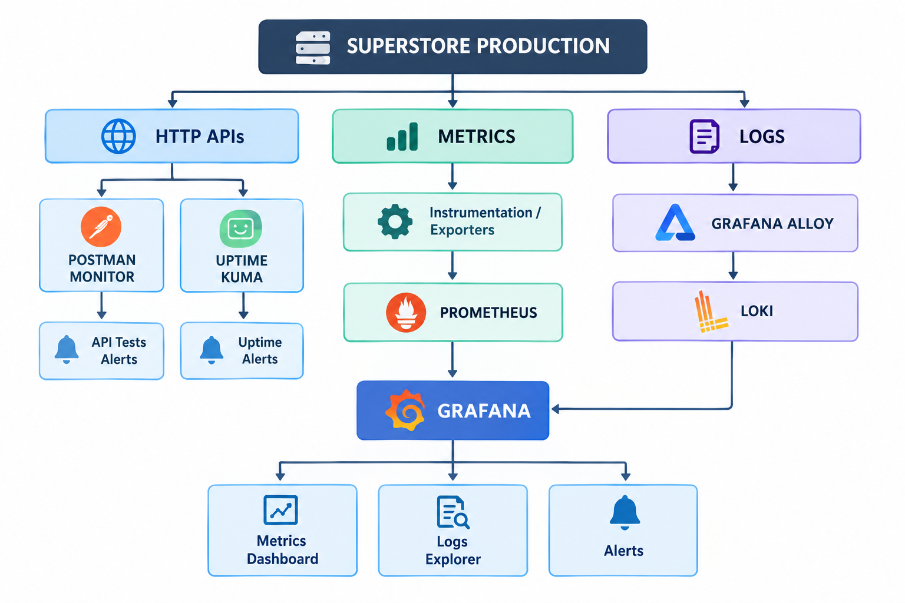

# Monitoring — System Architecture & Lineage



> Sơ đồ là kiến trúc mục tiêu. Hiện API đã có instrumentation Prometheus,
> endpoint `/metrics` nội bộ và HTTP/application logs; Prometheus, Grafana,
> Loki, Alloy, Uptime Kuma và Postman Monitor chưa được chạy như service trong
> production stack.

## 1. HTTP APIs — kiểm thử khả dụng và hành vi

| Thành phần | Vai trò | Câu hỏi trả lời |
| --- | --- | --- |
| Postman Monitor | Chạy collection API theo lịch | Endpoint có trả đúng status/body/contract không? |
| Uptime Kuma | Ping HTTP định kỳ, đo thời gian phản hồi | API hoặc website có đang truy cập được không? |
| API/Uptime alert | Gửi cảnh báo khi monitor fail | Khi nào cần người vận hành xử lý? |

Postman Monitor kiểm tra **đúng chức năng**. Uptime Kuma kiểm tra **còn truy cập
được**. Một endpoint có thể trả `200` nhưng payload sai; vì vậy hai loại kiểm tra
không thay thế nhau.

## 2. Metrics — theo dõi số liệu vận hành

```text
FastAPI instrumentation/exporter → Prometheus → Grafana Metrics Dashboard
```

| Thành phần | Vai trò | Ví dụ dữ liệu |
| --- | --- | --- |
| Instrumentation / exporter | Đo và xuất metrics từ ứng dụng/hạ tầng | request count, latency, status code, CPU, RAM |
| Prometheus | Pull và lưu metrics theo thời gian | error rate 5 phút, p95 latency, memory usage |
| Grafana Metrics Dashboard | Biểu diễn metrics bằng biểu đồ | traffic, lỗi 5xx, request chậm, resource usage |

Trong dự án hiện tại, `core/observability.py` tạo HTTP Counter/Histogram và
`api/routers/operations.py` có endpoint `/metrics`. Nginx production hiện không
public endpoint này; Prometheus sau này phải scrape qua mạng nội bộ/VPS, không
phải mở `/metrics` ra Internet.

## 3. Logs — truy vết sự kiện và lỗi

```text
API / Nginx / Docker logs → Grafana Alloy → Loki → Grafana Logs Explorer
```

| Thành phần | Vai trò | Dùng khi |
| --- | --- | --- |
| Grafana Alloy | Đọc, gắn nhãn và gửi logs | Thu thập log từ API, Nginx, Docker |
| Loki | Lưu trữ/tìm kiếm logs tập trung | Cần tìm request hoặc traceback cụ thể |
| Grafana Logs Explorer | Giao diện tìm, lọc và đối chiếu logs | Điều tra lỗi theo thời gian/request ID |

Logs đang có trên VPS:

| Nguồn | Đường dẫn | Nội dung |
| --- | --- | --- |
| FastAPI HTTP | `/opt/superstore/logs/api/http.log` | request ID, route, status, thời gian xử lý |
| FastAPI application | `/opt/superstore/logs/api/application.log` | startup, lỗi và thông báo ứng dụng |
| Nginx | `/var/log/nginx/superstore-*.log` | TLS, proxy và request đến public API |
| Docker | `compose.sh logs api redis` | stdout/stderr và traceback container |

`http.log` phục vụ truy vết từng request; nó không tự là Prometheus metric và
chưa tự được gửi lên Loki cho đến khi Alloy được cấu hình.

## 4. Grafana — trung tâm quan sát

Grafana kết nối hai nguồn dữ liệu độc lập:

```text
Prometheus → Metrics Dashboard / metric-based alert
Loki       → Logs Explorer / log-based alert
```

Grafana không thay Prometheus hay Loki. Nó hiển thị dữ liệu, tạo dashboard và
gửi alert dựa trên dữ liệu mà hai hệ thống này đã thu thập.

## 5. Phân biệt nhanh

| Thành phần | Trả lời câu hỏi |
| --- | --- |
| Postman Monitor | API có trả về kết quả đúng theo test không? |
| Uptime Kuma | API/website có đang hoạt động và truy cập được không? |
| Prometheus | Hệ thống hoạt động thế nào qua các chỉ số theo thời gian? |
| Loki | Đã xảy ra request, sự kiện hoặc lỗi gì? |
| Grafana | Metrics/logs đang cho thấy gì và khi nào phải cảnh báo? |

## 6. Thứ tự triển khai đề xuất

1. Giữ health checks/CD smoke hiện có làm baseline.
2. Cài Uptime Kuma cho public health endpoint.
3. Chạy Prometheus nội bộ để scrape `/metrics`, sau đó thêm Grafana dashboard.
4. Cài Alloy để chuyển API/Nginx/Docker logs vào Loki.
5. Tạo alert cho API down, tỷ lệ 5xx, latency cao và lỗi lặp lại.

Xem thêm [Deploy Operations](../operation.md),
[FastAPI VPS Check](../fastapi_vps_check.md) và
[Deploy Error Tracing](../error_tracing.md).
