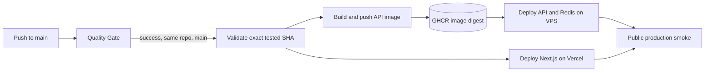
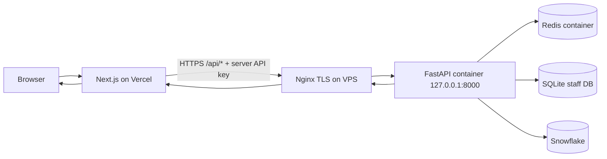
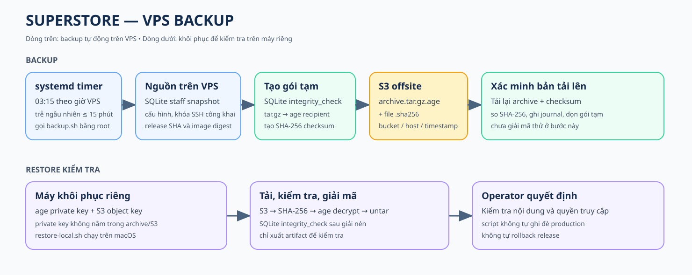
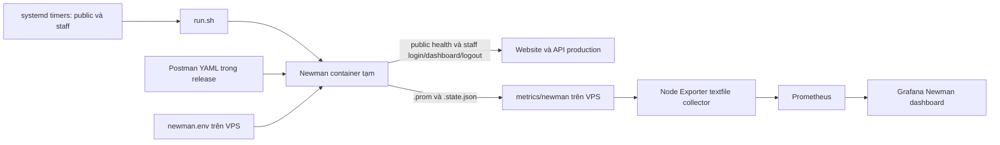

# Deploy — Architecture & Runtime Lineage

## 1. Release flow



Workflow kiểm tra SHA trước khi build/deploy và kiểm tra lại `main` trước bước production.
API image chạy trên VPS; frontend chạy trên Vercel. Workflow dùng GitHub Environment
`production` để lấy các biến/secret triển khai.
Quality Gate kiểm tra Newman bằng dữ liệu giả lập; CD chuyển cả `deploy/production`
và `postman` lên VPS. Lịch Newman được cài riêng bằng `newman/install.sh`.

## 2. Request flow sau deploy



Browser chỉ gọi same-origin Next BFF. Nginx chỉ chuyển `/api/` tới API; API port không
public, Redis không public. Public readiness, docs, OpenAPI và Prometheus metrics bị chặn.

## 3. File và dữ liệu trên VPS

```text
/etc/superstore/                         [GIỮ — cấu hình/secret lâu dài]
├── app.env                              [secret API, staff, Snowflake]
├── stack.env                            [API_DOMAIN]
├── grafana.env                          [secret Grafana/SMTP]
├── newman.env                           [GIỮ — URL và tài khoản sales dùng kiểm tra]
├── backup.env                           [GIỮ — AWS credential + age recipient; không vào archive]
├── images.source.env                    [tham chiếu image nguồn]
├── images.lock.env                      [digest images đã pin]
├── alertmanager/
│   ├── config.yml                       [route/receiver; container đọc read-only]
│   └── smtp_password                    [SMTP app password; container đọc read-only]
└── snowflake/                           [secret mount read-only]

/etc/sudoers.d/
└── superstore-deploy                    [GIỮ — rule sudo không cần nhập mật khẩu cho deploy.sh]

/opt/superstore/                         [GIỮ — release và runtime data]
├── releases/<COMMIT_SHA>/               [release immutable theo commit]
│   ├── deploy/production/               [Compose/scripts/templates]
│   │   ├── backup/                      [source backup/restore + install.sh]
│   │   ├── alertmanager/                [config mẫu; service nằm trong Compose chung]
│   │   └── newman/                      [runner, Dockerfile, timer, install.sh]
│   ├── postman/                          [collection YAML cho public/staff]
│   ├── images.lock.env                  [copy từ /etc nếu chưa có]
│   ├── release.env                      [TẠO TỰ ĐỘNG: API digest + SHA]
│   └── release.tar.gz                   [TẠM; workflow hiện chưa tự xóa]
├── current -> releases/<SHA>            [symlink release hiện hành]
├── previous -> releases/<SHA>           [symlink release trước]
├── data/staff/internal_users.db          [GIỮ — staff account]
├── logs/api/
│   ├── application.log                  [GIỮ — API application log]
│   └── http.log                         [GIỮ — structured HTTP log]
└── metrics/newman/                      [GIỮ, 755 — Node Exporter đọc tại đây]
    ├── newman-<public|staff>-<mode>.prom        [644 — kết quả Prometheus]
    └── newman-<public|staff>-<mode>.state.json  [600 — bộ đếm các lần chạy]

/etc/systemd/system/                     [sau khi chạy các install.sh]
├── superstore-newman@.service           [gọi run.sh public/staff]
├── superstore-newman@public.timer       [lịch public mỗi 5 phút]
├── superstore-newman@staff.timer        [lịch staff mỗi phút]
├── superstore-backup.service            [gọi bản backup.sh đã cài]
└── superstore-backup.timer              [03:15 giờ VPS; trễ ngẫu nhiên ≤15 phút]

/usr/local/lib/superstore-backup/        [GIỮ — backup/install.sh tạo]
└── backup.sh                            [bản chạy hằng ngày, root sở hữu]

/var/lib/superstore-backup/             [GIỮ — thư mục cha, root sở hữu]
└── work.XXXXXX/                        [TẠM — SQLite snapshot, archive, bản xác minh; dọn khi kết thúc bình thường]

API container /tmp/superstore-staff-backup.db [TẠM — xóa sau khi sao chép]
/var/lock/superstore-backup.lock        [GIỮ file; nhả khóa khi tiến trình kết thúc]

/var/lock/superstore-newman-<kind>.lock  [GIỮ file; nhả khóa khi lượt chạy kết thúc]

/etc/nginx/conf.d/                        [GIỮ — Nginx config đang dùng]
├── 00-superstore-logging.conf            [JSON access log format]
└── superstore-api.conf                   [proxy, TLS, route policy]

/etc/letsencrypt/                         [GIỮ — certificate/renewal]
/var/www/certbot/.well-known/acme-challenge/ [TẠM — challenge file khi xác minh]
/var/log/nginx/superstore-access.log      [GIỮ/rotate — Nginx access log]
/var/log/nginx/superstore-error.log       [GIỮ/rotate — Nginx error log]

Docker volume alertmanager_data            [GIỮ — trạng thái Alertmanager]

/home/deploy/.ssh/                         [GIỮ — quyền SSH vào VPS]
└── authorized_keys                        [public key tương ứng với VPS_SSH_KEY]
```

### Máy Mac dùng để thiết lập deploy

Các file này nằm trên máy Mac, tách biệt với filesystem VPS:

```text
~/.ssh/
├── superstore_github_actions              [PRIVATE KEY — lưu vào GitHub secret VPS_SSH_KEY]
└── superstore_github_actions.pub          [PUBLIC KEY — cài vào VPS /home/deploy/.ssh/authorized_keys]

/tmp/superstore_known_hosts                 [TẠM — host key lấy bằng ssh-keyscan;
                                             chỉ dùng sau khi fingerprint khớp với VPS]

/Users/macos/Desktop/Superstore_ecommerce/ [LOCAL — hai thư mục dưới bị Git ignore]
├── .config/superstore/
│   └── superstore-backup.agekey            [PRIVATE KEY — giải mã backup]
└── superstore-restore-drill/
    └── restore-*/                          [BẢN GIẢI MÃ — staff DB và cấu hình VPS]
```

## 4. Vai trò file runtime

| File                                      | Ai tạo/cập nhật               | Dùng để                                                                    |
| ----------------------------------------- | ----------------------------- | -------------------------------------------------------------------------- |
| `/etc/superstore/app.env`                 | Operator                      | API key, staff JWT, email domain, Snowflake config                         |
| `/etc/superstore/stack.env`               | Operator                      | Domain API của VPS                                                         |
| `/etc/superstore/backup.env`              | Operator                      | AWS credential và age public recipient; không đưa vào archive             |
| `/etc/superstore/newman.env`              | Operator                      | URL public và credential của staff sales kiểm tra; không đưa vào release  |
| `/etc/superstore/images.lock.env`         | `pin-images.sh`               | Digest các image; deploy copy vào từng release                              |
| `/opt/superstore/metrics/newman/*`        | Newman `run.js`               | Kết quả và bộ đếm để Node Exporter xuất cho Prometheus                     |
| `/usr/local/lib/superstore-backup/backup.sh` | `backup/install.sh`          | Bản script root chạy bằng systemd timer                                    |
| `/var/lib/superstore-backup/work.*`       | `backup.sh`                   | Vùng tạm chứa dữ liệu chưa mã hóa; dọn khi script kết thúc                 |
| `/etc/sudoers.d/superstore-deploy`        | Operator qua `visudo`         | Cho phép `deploy` gọi lệnh deploy theo rule đã cấu hình                    |
| `release.env`                             | `deploy.sh`                   | API image digest và SHA chạy bởi Compose                                   |
| `current`, `previous`                     | `deploy.sh`                   | Trỏ release hiện hành/trước                                                |
| `/home/deploy/.ssh/authorized_keys`       | Operator                      | Public key được phép cho GitHub runner SSH vào VPS; không chứa private key |
| `$RUNNER_TEMP/superstore-ssh/id_key`      | Workflow từ `VPS_SSH_KEY`     | Private key tạm để runner kết nối SSH; cleanup sau job                     |
| `$RUNNER_TEMP/superstore-ssh/known_hosts` | Workflow từ `VPS_KNOWN_HOSTS` | Xác minh danh tính VPS khi SSH; cleanup sau job                            |
| ACME challenge token                      | Certbot/ACME                  | Chứng minh domain sở hữu tạm thời                                          |

Vận hành và bootstrap: [operation.md](operation.md). Truy vết stage lỗi:
[error_tracing.md](error_tracing.md).

## 5. Backup offsite



Backup là nhánh vận hành riêng: systemd timer gọi `backup.sh` trên VPS, tạo
snapshot SQLite staff nhất quán, gom cấu hình và metadata release, mã hóa bằng
age public recipient rồi lưu `.age` và `.sha256` lên S3. Sau upload, script tải
lại hai file để kiểm tra checksum. Private key chỉ dùng trên máy khôi phục.

Phạm vi là staff DB và cấu hình VPS; Snowflake, Redis, logs và image/source
release không nằm trong archive. Restore drill tải object về máy khôi phục,
kiểm tra checksum, giải mã và chạy SQLite integrity check. Bản restore local
ngày 2026-11-14 đã đạt; khôi phục VPS mới chưa được diễn tập. Chi tiết:
[Backup Architecture](backup/system_architecture_lineage.md) và
[Backup Discovery Result](backup/discovery_result.md).

`backup.env` và `newman.env` không được script đưa vào archive; khi dựng VPS mới
cần cấu hình lại hai file này. Bản mã hóa và checksum được giữ trên S3, không
giữ trong `work.*` sau lượt backup thành công.

## 6. Newman — kiểm tra luồng production theo lịch



`install.sh` cài hai timer; mỗi timer gọi `run.sh` theo collection tương ứng.
Runner dựng image `superstore-newman:<release SHA>` khi chưa có, chạy container
`--rm`, đọc Postman YAML và `newman.env` từ VPS. `run.js` ghi kết quả từng request,
thời gian, số assertion lỗi và trạng thái lượt chạy vào `metrics/newman/`;
Node Exporter chỉ đọc thư mục đó. Public không cần đăng nhập; staff dùng tài khoản
sales riêng để kiểm tra login, cookie, dashboard, cache và logout.

Credential ở `/etc/superstore/newman.env`; file `.prom` chỉ chứa tên request và
số liệu, không chứa password/cookie. CD chuyển source lên VPS nhưng không tự cài
timer. Trạng thái đã chạy thật xem [Monitoring Discovery Result](monitoring/discovery_result.md);
cách cài và kiểm tra xem [Synthetic Baseline](monitoring/synthetic_baseline.md).
