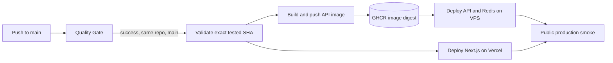
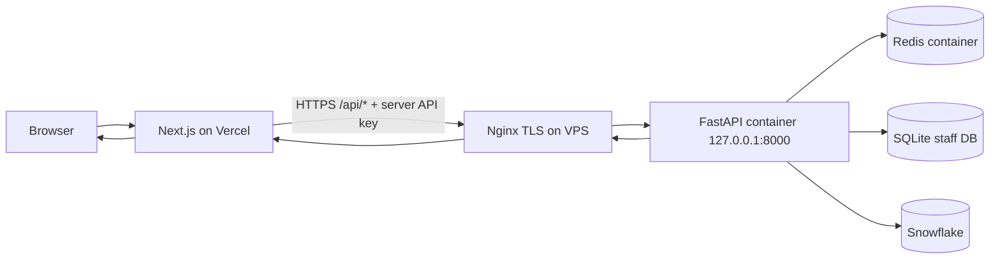

# Deploy — Architecture & Runtime Lineage

## 1. Release flow



Workflow kiểm tra SHA trước khi build/deploy và kiểm tra lại `main` trước bước production.
API image chạy trên VPS; frontend chạy trên Vercel. Workflow dùng GitHub Environment
`production` để lấy các biến/secret triển khai.

## 2. Request flow sau deploy



Browser chỉ gọi same-origin Next BFF. Nginx chỉ chuyển `/api/` tới API; API port không
public, Redis không public. Public readiness, docs, OpenAPI và Prometheus metrics bị chặn.

## 3. File và dữ liệu trên VPS

```text
/etc/superstore/                         [GIỮ — cấu hình/secret lâu dài]
├── app.env                              [secret API, staff, Snowflake]
├── stack.env                            [API_DOMAIN]
├── images.lock.env                      [digest Redis đã pin]
└── snowflake/                           [secret mount read-only]

/etc/sudoers.d/
└── superstore-deploy                    [GIỮ — rule sudo không cần nhập mật khẩu cho deploy.sh]

/opt/superstore/                         [GIỮ — release và runtime data]
├── releases/<COMMIT_SHA>/               [release immutable theo commit]
│   ├── deploy/production/                [Compose/scripts/templates]
│   ├── images.lock.env                  [copy từ /etc nếu chưa có]
│   ├── release.env                      [TẠO TỰ ĐỘNG: API digest + SHA]
│   └── release.tar.gz                   [TẠM; workflow hiện chưa tự xóa]
├── current -> releases/<SHA>            [symlink release hiện hành]
├── previous -> releases/<SHA>           [symlink release trước]
├── data/staff/internal_users.db          [GIỮ — staff account]
└── logs/api/
    ├── application.log                  [GIỮ — API application log]
    └── http.log                         [GIỮ — structured HTTP log]

/etc/nginx/conf.d/                        [GIỮ — Nginx config đang dùng]
├── 00-superstore-logging.conf            [JSON access log format]
└── superstore-api.conf                   [proxy, TLS, route policy]

/etc/letsencrypt/                         [GIỮ — certificate/renewal]
/var/www/certbot/.well-known/acme-challenge/ [TẠM — challenge file khi xác minh]
/var/log/nginx/                           [GIỮ/rotate — Nginx access/error logs]

/home/deploy/.ssh/                         [GIỮ — quyền SSH vào VPS]
└── authorized_keys                        [public key tương ứng với VPS_SSH_KEY]
```

### Máy Mac dùng để thiết lập deploy

Các file này nằm trên máy Mac, tách biệt với filesystem VPS:

```text
~/.ssh/
├── superstore_github_actions              [PRIVATE KEY — lưu vào GitHub secret VPS_SSH_KEY]
└── superstore_github_actions.pub          [PUBLIC KEY — cài vào VPS /home/deploy/.ssh/authorized_keys]

/tmp/superstore_known_hosts                 [TẠM — host key lấy bằng ssh-keyscan;
                                             chỉ dùng sau khi fingerprint khớp với VPS]
```

## 4. Vai trò file runtime

| File                                      | Ai tạo/cập nhật               | Dùng để                                                                    |
| ----------------------------------------- | ----------------------------- | -------------------------------------------------------------------------- |
| `/etc/superstore/app.env`                 | Operator                      | API key, staff JWT, email domain, Snowflake config                         |
| `/etc/superstore/stack.env`               | Operator                      | Domain API của VPS                                                         |
| `/etc/superstore/images.lock.env`         | `pin-images.sh`               | Digest Redis; deploy copy vào từng release                                 |
| `/etc/sudoers.d/superstore-deploy`        | Operator qua `visudo`         | Cho phép `deploy` gọi lệnh deploy theo rule đã cấu hình                    |
| `release.env`                             | `deploy.sh`                   | API image digest và SHA chạy bởi Compose                                   |
| `current`, `previous`                     | `deploy.sh`                   | Trỏ release hiện hành/trước                                                |
| `/home/deploy/.ssh/authorized_keys`       | Operator                      | Public key được phép cho GitHub runner SSH vào VPS; không chứa private key |
| `$RUNNER_TEMP/superstore-ssh/id_key`      | Workflow từ `VPS_SSH_KEY`     | Private key tạm để runner kết nối SSH; cleanup sau job                     |
| `$RUNNER_TEMP/superstore-ssh/known_hosts` | Workflow từ `VPS_KNOWN_HOSTS` | Xác minh danh tính VPS khi SSH; cleanup sau job                            |
| ACME challenge token                      | Certbot/ACME                  | Chứng minh domain sở hữu tạm thời                                          |

Vận hành và bootstrap: [operation.md](operation.md). Truy vết stage lỗi:
[error_tracing.md](error_tracing.md).
