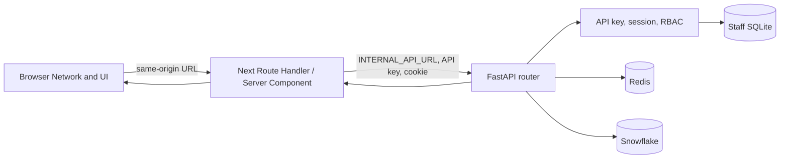

# Frontend — Truy vết lỗi Browser → Next.js → FastAPI

## 1. Luồng cần khoanh vùng



Browser gọi `/api/internal/...`; route Next kiểm tra allowlist và Origin, sau đó mới
chuyển request tới FastAPI. Khi lỗi, lấy status và `detail` từ Network tab trước.

## 2. Ý nghĩa các nhóm lỗi

| Response | Khả năng chính | Kiểm tra |
|---|---|---|
| `0` / request không tới Next | Next chưa chạy, sai origin hoặc browser/network lỗi | DevTools Network; Next process/container |
| `401` | Cookie thiếu/hết hạn, account sai hoặc session bị revoke | Login lại; kiểm tra `/staff/me` và cookie browser |
| `403` | API key sai, role thiếu quyền hoặc POST Origin sai | Đồng bộ API key; kiểm tra role và `Frontend_Origin` |
| `404 Internal route is not allowed` | BFF path không nằm trong allowlist | So path + method với route.ts |
| `404` từ metric | Metric không được khai báo ở FastAPI | So tên với `DASHBOARD_QUERIES` |
| `405` | Method chưa được BFF hỗ trợ | Route chỉ export GET/POST |
| `413` / `415` | Login body quá lớn hoặc không phải JSON | Request body/content type |
| `422` | Tháng không theo `YYYYMM01`, range ngược hoặc limit ngoài `1–100` | Query string |
| `429` | Login vượt rate limit | Chờ `Retry-After`; kiểm tra Redis/API client IP |
| `500 Internal API is not configured` | `API_KEY`, URL hoặc production `Frontend_Origin` thiếu/sai | Next server environment; restart/redeploy sau khi đổi |
| `502 Internal API is unavailable` | Next không kết nối được FastAPI | `INTERNAL_API_URL`, DNS, port, container/service logs |
| `502` từ FastAPI | Snowflake query hoặc data contract thất bại | FastAPI log, Snowflake role/schema, metric contract |
| `503` từ `/api/health` Next | Next không nhận liveness hợp lệ từ FastAPI | Upstream URL, API liveness, Next logs |
| `503` từ FastAPI | API key chưa cấu hình hoặc readiness dependency lỗi | Response body phân biệt; xem API operation |
| `504` | Next upstream request vượt timeout 15 giây | FastAPI/query runtime; không tăng timeout trước khi tìm nguyên nhân |

## 3. Vị trí log và lệnh kiểm tra

Local hoặc Docker development, từ `data_platform`:

```bash
docker compose logs --tail=100 frontend api redis
```

Production:

- GitHub Actions → workflow `Superstore Production` → job `Deploy API and frontend, then smoke test`.
- Frontend request/runtime logs: Vercel project → production deployment → runtime logs.
- API/Nginx logs: xem [Deploy Operations](../deploy/operation.md).

Next BFF ghi `internal_proxy` khi upstream response được xử lý; lỗi kết nối ghi event
`internal_proxy_failed`, không in key/cookie. FastAPI middleware thêm `x-request-id`
cho request thường; cung cấp ID này khi đối chiếu log. `/api/health/live`,
`/api/health/ready` và `/metrics` bị loại khỏi HTTP request log.

FastAPI direct check trong development:

```bash
curl -i http://localhost:8000/health/live
curl -i http://localhost:8000/health/ready
```

`/health/ready` query Snowflake; `/api/health/ready` chỉ kiểm tra staff SQLite/Redis.
Production Nginx không expose readiness endpoint.

## 4. Thứ tự khoanh vùng

1. Network tab: URL, method, status, `detail`, request ID.
2. Nếu URL là `/api/internal/...`, xem Next/Vercel log và kiểm tra BFF config.
3. Gọi FastAPI liveness trực tiếp ở local/container; xác minh `INTERNAL_API_URL` từ môi trường Next.
4. Nếu nhận `401/403`, kiểm tra cookie, key, Origin và role theo từng lớp.
5. Nếu nhận `502/503`, xem FastAPI log/readiness; xác định Redis, SQLite hay Snowflake.
6. Không ghi API key, password, JWT/cookie hoặc `.env` vào issue/log đính kèm.

API route và môi trường: [API Operations](../API/operation.md). Cách chạy frontend:
[operation.md](operation.md).
