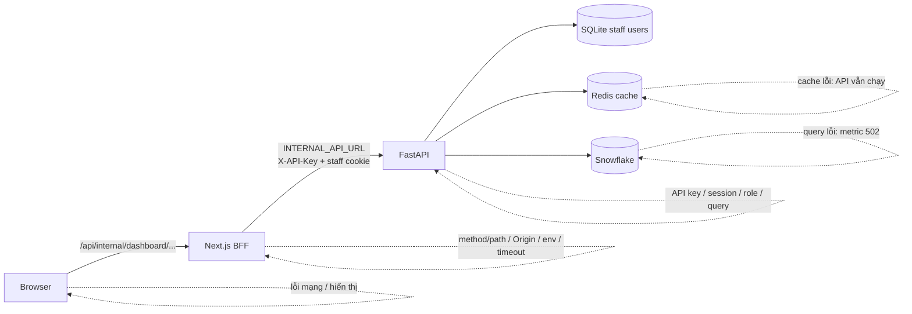
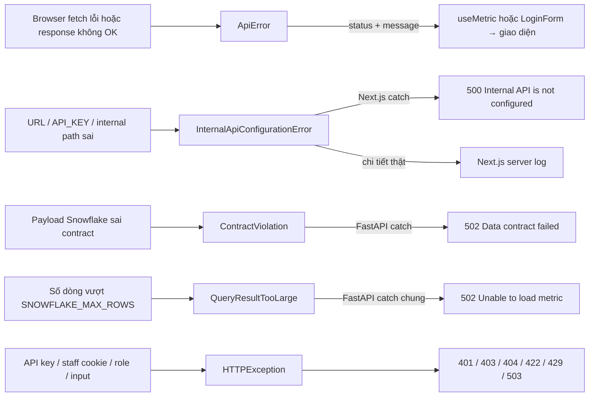
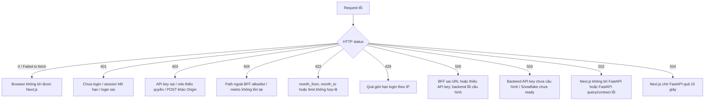
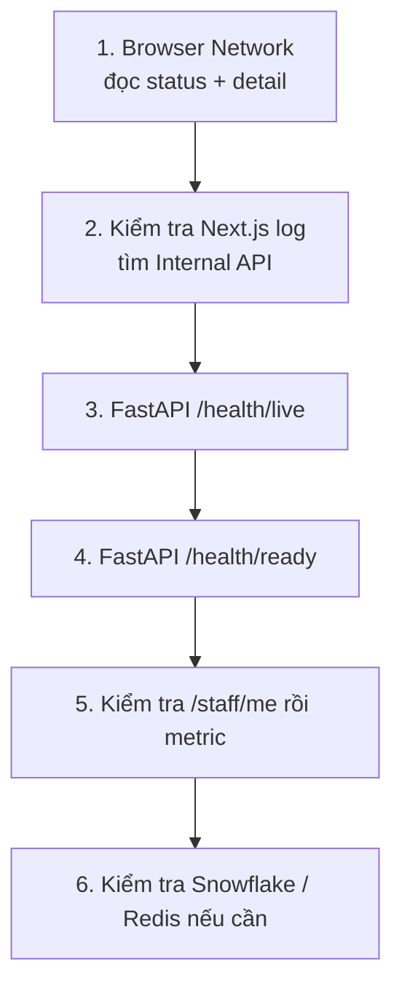

# Truy vết lỗi Browser → Next.js BFF → FastAPI → Redis/Snowflake

## 1. Luồng request



Next.js nhận GET cho `/dashboard*`, `/staff/me` và POST cho `/staff/login`,
`/staff/logout`. BFF gắn `API_KEY`, chuyển cookie staff tới FastAPI và trả
`Set-Cookie` của login/logout về browser. Metric lạ do FastAPI trả `404`.

## 2. Error class và cách lỗi được truyền



`InternalApiConfigurationError`, `ContractViolation` và lỗi Snowflake không trả stack trace
cho browser. Muốn thấy nguyên nhân gốc phải xem log đúng tầng.

## 3. Xác định lỗi theo response



| Dấu hiệu                               | Error class/nhóm lỗi             | Kiểm tra đầu tiên                                         | Vị trí lỗi thường gặp                    |
| -------------------------------------- | -------------------------------- | --------------------------------------------------------- | ---------------------------------------- |
| Status `0`, `Failed to fetch`          | `ApiError`                       | Browser Network và Next.js có chạy không                  | Client → Next.js                         |
| `404 Internal route is not allowed`    | Next.js method/path allowlist    | Kiểm tra GET/POST và path trong `isAllowedRoute`           | Next.js route proxy                      |
| `401 Staff authentication is required` | `HTTPException`                  | Login chưa, cookie `superstore_staff` có được gửi không    | Browser → BFF → FastAPI session          |
| `401 Staff session is invalid or expired` | `HTTPException`                | Login lại; kiểm tra TTL, secret và `auth_version`          | FastAPI staff session                    |
| `401 Email or password is incorrect`   | `HTTPException`                  | Staff active, domain email, mật khẩu                       | FastAPI staff login                      |
| `403 Invalid or missing API key`       | `HTTPException`                  | `API_KEY` của Next.js và FastAPI phải giống nhau          | Next.js → FastAPI auth                   |
| `403 Your role cannot access...`       | `HTTPException`                  | Role trong `/staff/me`, nhóm metric trong contract         | FastAPI dashboard authorization          |
| `403 Cross-site request is not allowed` | Next.js Origin guard            | `Frontend_Origin` phải khớp đúng Origin của browser       | Browser → BFF                            |
| `429`                                  | Login rate limit                 | Số lần thử/phút theo IP API nhìn thấy; chờ `Retry-After`  | FastAPI → Redis hoặc fallback nội bộ     |
| `422`                                  | `HTTPException`                  | `month_from <= month_to`, dạng `YYYYMM01`, `limit=1..100` | FastAPI validation                       |
| `500 Internal API is not configured`   | `InternalApiConfigurationError`  | `API_KEY` trống/placeholder hoặc `INTERNAL_API_URL` sai cú pháp/giao thức | Next.js server env |
| `/dashboard` lỗi server trước khi hiện giao diện | `internalFetch` trong server layout | Kiểm tra `/api/staff/me` upstream, `API_KEY` và log Next.js | Next.js layout → FastAPI |
| `500` khi staff login                  | `RuntimeError`                  | `STAFF_JWT_SECRET` phải dài ít nhất 32 ký tự              | FastAPI session config                   |
| `503 /health/ready`                    | Snowflake exception              | Chi tiết `services.snowflake`                             | FastAPI → Snowflake                      |
| `503 Internal authentication is not configured` | `HTTPException`         | `API_KEY` trống/placeholder trong FastAPI                 | FastAPI auth                             |
| `502 Internal API is unavailable`      | Fetch/connection exception       | FastAPI có chạy, URL/port/DNS đúng                         | Next.js → FastAPI                        |
| `504 Internal API request timed out`   | Fetch timeout                    | FastAPI chậm hơn 15 giây; kiểm tra log/API/Snowflake      | Next.js → FastAPI                        |
| `502 Unable to load metric`            | `QueryResultTooLarge` hoặc query | Snowflake role/schema/table/query, `SNOWFLAKE_MAX_ROWS`   | FastAPI analytics                        |
| `502 Data contract failed`             | `ContractViolation`              | Tên và kiểu cột query trả về                              | FastAPI contract                         |
| Redis unavailable                      | Redis exception                  | `/health/ready.services.redis`                            | Không chặn API; request chạy không cache |

`INTERNAL_API_URL` bị thiếu sẽ mặc định là `http://api:8000`; khi chạy Next.js
trực tiếp trên máy, thiếu cấu hình này thường gây **502 kết nối**, không phải
`500`. Login rate limit ưu tiên Redis; khi Redis không khả dụng thì fallback
trong tiến trình API, nên bộ đếm không chia sẻ giữa các worker/container.

## 4. Thứ tự kiểm tra



```bash
# FastAPI process
curl -i http://localhost:8000/health/live
curl -i http://localhost:8000/health/ready

# Log khi chạy bằng Docker Compose
cd data_platform
docker compose logs --tail=100 frontend api redis

# Gọi FastAPI trực tiếp sau khi login và lưu cookie theo docs/API/operation.md
curl -i -b "$STAFF_COOKIE_JAR" \
  -H "X-API-Key: $API_KEY" \
  http://localhost:8000/api/staff/me
```

## 5. Cách khoanh vùng nhanh

- Gọi FastAPI trực tiếp **thành công** với key + cookie, nhưng qua `/api/internal/...`
  lỗi: kiểm tra cookie được forward và Next.js BFF.
- `/staff/me` trả `401`: login lại; nếu `403` thì kiểm tra API key trước.
- `/health/live` lỗi: FastAPI chưa chạy hoặc sai port.
- `/health/live` đạt nhưng `/health/ready` lỗi: kiểm tra Snowflake.
- Readiness đạt nhưng metric lỗi `502`: kiểm tra query, schema và data contract.
- Response đúng nhưng giao diện lỗi: kiểm tra browser console và component render.

Swagger không hiển thị `Set-Cookie` trong response panel; kiểm tra DevTools
Application/Network hoặc gọi `/staff/me`. Không ghi `API_KEY`, JWT cookie,
`STAFF_JWT_SECRET`, Snowflake password hoặc toàn bộ `.env` vào log/ticket.
