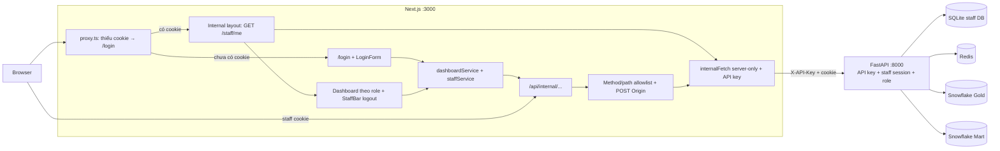
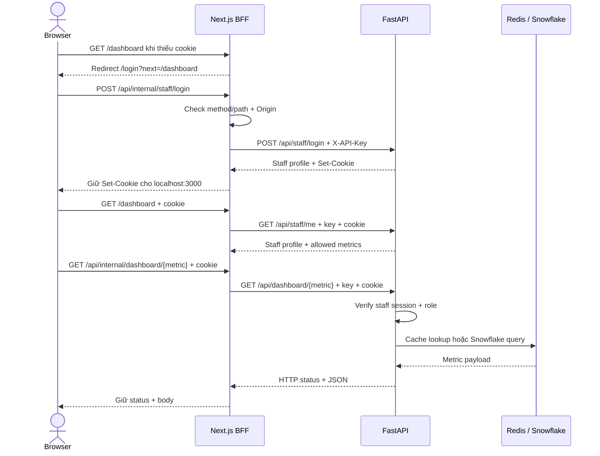
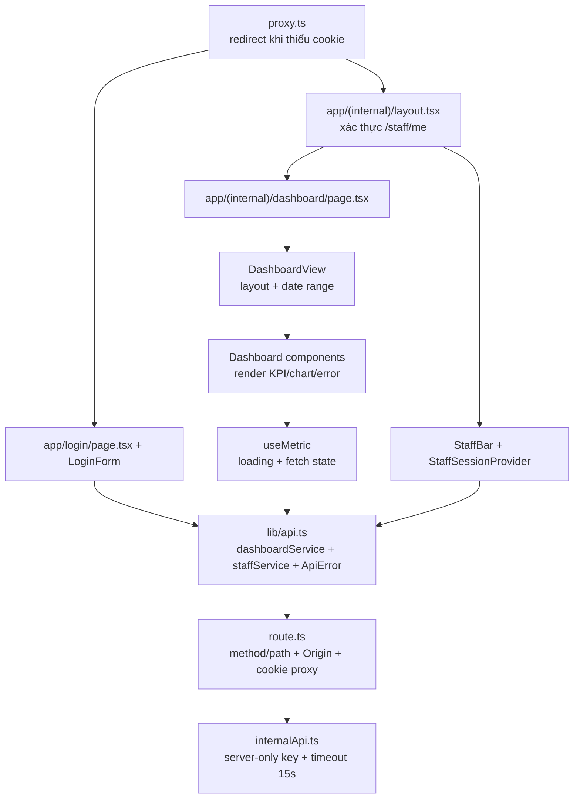

# Frontend System Architecture & Lineage

Frontend là Next.js BFF cho dashboard nội bộ. Browser giữ cookie `HttpOnly`
`superstore_staff`; `API_KEY` chỉ nằm ở Next.js server. Đã có trang login,
redirect khi chưa đăng nhập, xác thực session phía server và logout.

## 1. Kiến trúc

## 2. Luồng dữ liệu dashboard

`LoginForm` gọi `staffService.login`; layout server gọi trực tiếp `/api/staff/me`
qua `internalFetch` (không dùng `staffService.me`); `StaffBar` gọi
`staffService.logout`. `proxy.ts` chỉ kiểm tra cookie
có tồn tại để redirect sớm, **không** tự xác thực chữ ký/role. Dashboard chỉ
render metric trong `StaffProfile.metrics`; FastAPI vẫn kiểm tra quyền từng request.

| Giao diện | Metric API | Giá trị business |
|---|---|---|
| KPI cards | `kpi` | Revenue, profit, orders, AOV, margin |
| Revenue trend | `revenue-trend` | Xu hướng doanh thu theo tháng |
| Category breakdown | `by-category` | Hiệu quả theo nhóm hàng |
| Region breakdown | `by-region` | Hiệu quả theo khu vực |
| Top products | `top-products` | Sản phẩm đóng góp doanh thu cao nhất |

## 3. Trách nhiệm module

## 4. Security boundary

- `API_KEY` chỉ được đọc trong Next.js server và gắn vào upstream request.
- BFF cho `GET /staff/me`, `GET /dashboard*`, `POST /staff/login` và
  `POST /staff/logout`; FastAPI từ chối metric lạ. `dashboard/*` hiện được
  forward theo prefix, chưa có allowlist cố định năm metric ở BFF.
- BFF chuyển cookie tới FastAPI và chuyển `Set-Cookie` của login/logout về browser.
  Browser không đọc được giá trị cookie `HttpOnly` bằng JavaScript.
- POST có `Origin` khác origin của Next.js bị trả `403`; POST không có Origin
  được phép để hỗ trợ curl/server-side client.
- Không còn preview guard hay phụ thuộc `ALLOW_UNAUTHENTICATED_INTERNAL_UI`.
  `.env.example` vẫn chứa cờ cũ nhưng code không đọc nó.
- POST từ Origin khác `Frontend_Origin` bị chặn; request không có Origin được
  chấp nhận cho CLI/server-side client. Cấu hình phải đúng origin browser thực tế.
- Next.js không cache request; FastAPI dùng Redis cho metric và rate limit login,
  fallback trong tiến trình nếu Redis lỗi.

Luồng truy vết lỗi chi tiết: [error_tracing.md](error_tracing.md).
