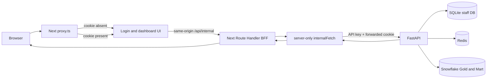

# Frontend — Architecture & Request Lineage

## 1. Luồng tổng thể



Browser không gọi FastAPI trực tiếp. `API_KEY` chỉ tồn tại ở Next server; staff cookie
là cookie cùng origin với giao diện.

## 2. Request mapping

| Browser → Next.js | Next.js → FastAPI |
|---|---|
| `POST /api/internal/staff/login` | `POST /api/staff/login` |
| `GET /api/internal/staff/me` | `GET /api/staff/me` |
| `POST /api/internal/staff/logout` | `POST /api/staff/logout` |
| `GET /api/internal/dashboard/{metric}` | `GET /api/dashboard/{metric}` |
| `GET /api/health` | `GET /api/health/live` |

BFF chỉ nhận các path/method được khai báo trong `app/api/internal/[...path]/route.ts`.
POST bắt buộc có `Origin` khớp `Frontend_Origin`; BFF chuyển cookie và `Set-Cookie`,
không chuyển API key ra browser.

## 3. Xác thực dashboard

1. `proxy.ts` kiểm tra có cookie `superstore_staff` không; thiếu thì redirect `/login`.
2. `(internal)/layout.tsx` gọi FastAPI `/api/staff/me` bằng `internalFetch` để xác minh
   token, account active và `auth_version`.
3. Layout cung cấp profile; giao diện hiển thị những metric trong `profile.metrics`.
4. Mỗi request metric vẫn được FastAPI kiểm tra API key, cookie và role.

Cookie chỉ hiện diện không đồng nghĩa session hợp lệ; bước 2 là kiểm tra có thẩm quyền.

## 4. Module map

```text
proxy.ts                                 Redirect sớm khi thiếu staff cookie
app/login/page.tsx + LoginForm           Form đăng nhập
app/(internal)/layout.tsx                Xác thực session server-side; dựng staff context
app/(internal)/dashboard/page.tsx        Trang dashboard
components/auth/                         Login, staff bar, session context
components/dashboard/                    KPI, charts, range, loading/error state
lib/api.ts                               Browser services gọi same-origin BFF
app/api/internal/[...path]/route.ts      Path/method allowlist, Origin guard, cookie proxy
lib/server/internalApi.ts                Server-only upstream URL/API key/timeout
app/api/health/route.ts                  Probe Next → FastAPI liveness
```

## 5. Security boundary

- `proxy.ts` chỉ redirect sớm; không xác minh chữ ký JWT và không cấp quyền.
- BFF POST chặn Origin khác; GET chỉ chuyển route allowlist.
- FastAPI mới là nguồn quyết định session và RBAC.
- BFF và browser dùng same-origin; browser không nhận `X-API-Key`.
- Login/logout gửi `Set-Cookie` và xóa cookie ở BFF response; flag bảo mật do FastAPI
  cấu hình, production phải dùng HTTPS và `Secure` cookie.
- `/api/health` chỉ báo Next có gọi được FastAPI liveness; không phải kiểm tra Snowflake.

Vận hành: [operation.md](operation.md). Truy vết lỗi:
[error_tracing.md](error_tracing.md). API boundary:
[API Architecture](../API/system_architecture_lineage.md).
